# Can we tell who wrote a skill? What skillsig shows

2026-10-27 · Local research report, developed from the earlier online document.
Charts are drawn by `python -m skillsig export` into [figures/report/](../../figures/report/)
from saved stage outputs. Specificity (step 2.8) and the two text-model experiments
that read it (3.5, 3.6) were rebuilt on 2026-10-27 on the current near-duplicate
clusters; the rebuild moved the reported text-model AUCs by less than 0.001.

## Answer supported by the current evidence

Explicit disclosures provide evidence of agent involvement. Exact sharing and
similarity signals identify substantial content reuse and candidate reuse. The tested
text models distinguish proxy labels moderately, but offer limited coverage at high
precision under the evaluated class balance. Reliable human-authorship identification
remains unestablished. Neither a missing disclosure nor a low text score establishes
human authorship, and these results do not prove that text-based methods cannot work.

## Primary evidence view: reuse and agent disclosure are independent

The analysis now separates content reuse from observed agent involvement. A copied
or near-duplicate skill can also have an agent disclosure in its representative's
commit history. Their co-occurrence is not a contradiction. The historical v2.1
labels, their confidence and the independent annotation answers are preserved for
comparison; the new view does not assign a human-authorship category.
Separate axes do not imply the signals are statistically independent.

| Reuse evidence (compact display category) | Agent involvement disclosed | No disclosure observed | History unavailable |
|---|---:|---:|---:|
| Exact content shared | 35,655 | 85,003 | 268,472 |
| Near-duplicate signal | 19,160 | 49,945 | 341,050 |
| Scaffold signal only | 2,212 | 4,488 | 29,543 |
| No reuse signal observed | 98,595 | 154,278 | 759,588 |
| Reuse not assessed | 2,152 | 6,649 | 21,191 |
| **Total** | **157,774** | **300,363** | **1,419,844** |

Source: [reuse × disclosure matrix](../../results/s3_evidence_matrix.csv),
[supporting totals](../../results/s3_evidence_summary.json), all 1,877,981 distinct skills.
The matrix chooses exact before near before scaffold for a compact display. Overlapping
flags remain separately available in the row-level evidence and signal-count outputs.

**57,027 of the 157,774 skills with disclosed involvement (36.1%) also have reuse
signals.** Within the older `highly_templated` label alone, 14,706 skills have
disclosed involvement that the exclusive headline label does not show.

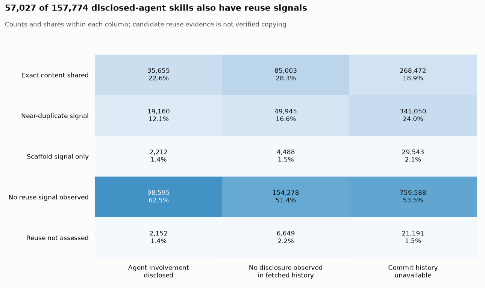

Exact sharing means equal bytes in at least two files and does not establish who
copied whom. Near-duplicate clusters use candidate/transitive LSH components, and
scaffold additions remain incompletely validated. These are observed evidence
categories, not newly validated templated labels. The old templated rule required
ten copies or cluster members; this view records sharing/candidate evidence from two.

No disclosure observed means none in the available first/last commit view. It does
not mean no AI use, and unavailable history is kept separate. A disclosure can refer
to installation or maintenance rather than original writing. The existing blind
annotations assess the historical taxonomy and do not validate the new dimensions.
See [definitions and reproducible commands](../stages/s3_labeling/evidence.md).

## Historical label analyses and their limitations

The following results retain the original exclusive taxonomy for comparison. They
must not be read as a validated separation of copying, agent use and human authorship.

**Question:** can we tell human-written, agent-assisted and templated skills apart from public repository data, and how reliable is that signal? (See [RESEARCH_QUESTION.md](../../RESEARCH_QUESTION.md).)

**Scope:** the historical rules leave 73% of distinct skills as `insufficient_evidence`.
That is their coverage under the available data and thresholds, not proof of an
intrinsic limit on authorship detection. The independent evidence view above reports
reuse and disclosure separately.

| # | Claim | Verdict | Deciding number |
| --- | --- | --- | --- |
| 1 | Exact registry content can be recovered | **Supported for content identity** | Generic rules recover 87.2% of 6,481 exact matches; copy count alone recovers 56.5%. Near matches are evaluated separately |
| 2 | Disclosure-based rules identify visible agent evidence | **Indicative agreement with a reader** | A agrees with 25/30 v2.1 agent labels and 23/28 trailer-only labels; superiority is not established |
| 3 | Historical likely-human labels identify true human authorship | **Not validated** | A agrees with 6/30; on the common sample A agrees with 2/10 and B with 6/10; C agrees with 3/9 |
| 4 | Tested text methods distinguish the evaluated proxy groups | **Moderate discrimination, limited high-precision coverage** | Best AUC 0.71; at a nominal 90% proxy precision, coverage is 0.9% of positives and 7.1% of negatives under a 50/50 prior |
| 5 | Aggregate label shares change little under some tested settings | **Descriptive sensitivity result** | The largest shift is +3.3 percentage points for templated share at cluster setting 0.6; individual decision stability is not measured |

The research plan named five simpler explanations the labels had to beat:

| Simpler explanation | Verdict | Finding |
| --- | --- | --- |
| "Templated" is just a copy count | Cluster evidence adds recovery on exact registry matches; broader templating precision remains unvalidated | 1 |
| "Agent" just means the skill sits in a `.claude/` folder | Folder-only agreement is lower in this sample; tool-family confounding is not excluded | 2 |
| An AI trailer only records who ran an install | Unresolved: similar trailer-only performance does not establish whether a commit authored, installed or maintained the content | 2 |
| The labels only reflect when a repository adopted skills | Unresolved: the available commit-date baseline is weak in a separate experiment; repository creation date remains untested | 4 |
| No separable signal between agent and human text | True-authorship separation remains unestablished; proxy-label AUC 0.71 shows some discrimination and does not support a no-signal conclusion | 4 |

## Finding 1: Exact registry content is recovered; near candidates need paired review

**Claim.** Generic copy-count and cluster rules recover registry content beyond a copy-count threshold alone.

**Test.** Use 6,481 exact registry matches, excluding known origin representatives, as
content-identity positives. Separately report agreement on 42,104 near candidates
selected by similarity. Near candidates share the MinHash mechanism with clustering,
so they are not an independent known-copy reference. The old mixed set of 48,585
must not be used as an independent validation denominator.

**Result.** On exact matches, copy count recovers 3,661/6,481 (56.5%), clusters
4,316/6,481 (66.6%), and either rule 5,649/6,481 (87.2%; descriptive Wilson interval
86.3–88.0%). Agreement on near candidates is 87.3% for either rule, conditional on
similarity selection. These rates measure positive-reference coverage, not overall
precision, copying direction, true authorship or lightly customized scaffolding.

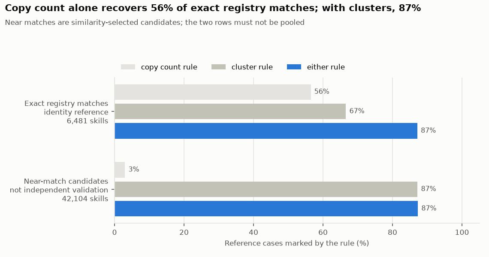

*Source: `results/s4_template_provenance.csv` · 6,481 exact matches and 42,104 near candidates, reported separately*

The cluster rule rests on near-duplicate clusters, built by comparing short fingerprints of every skill instead of every pair of texts:

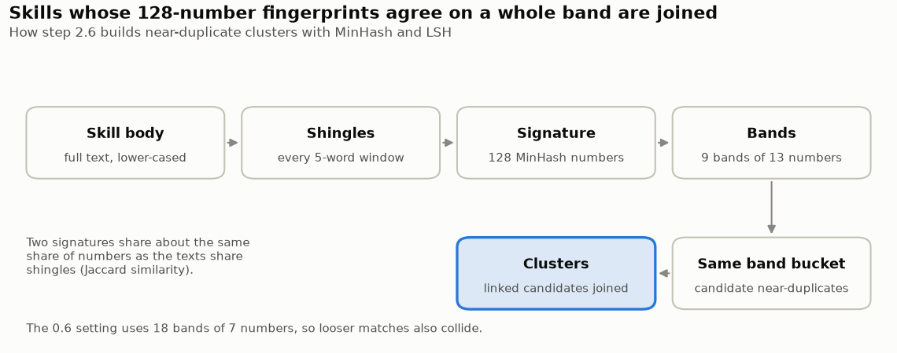

*Step 2.6 method · settings from `config/default.yaml`*

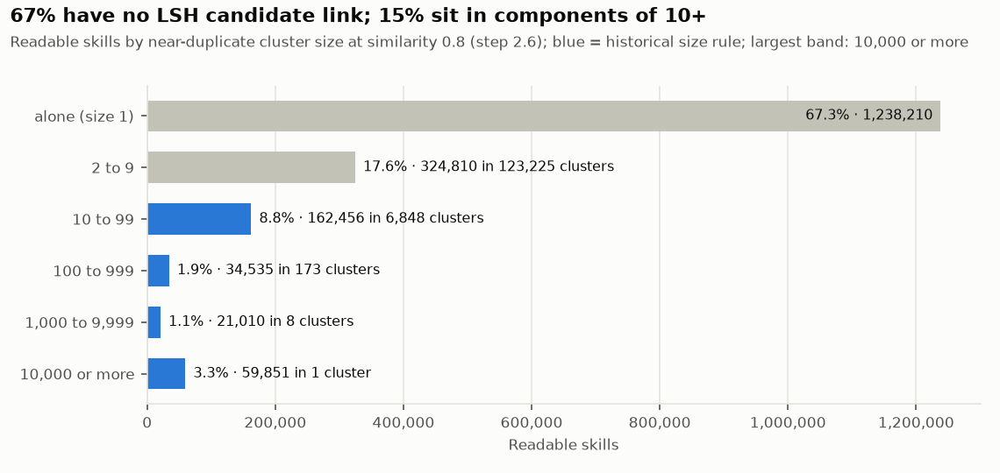

*Source: `src/data/derived/s2_clusters.parquet` · 1,840,872 readable skills at similarity 0.8*

One component holds 59,851 skills. Candidate links can chain, so component membership
does not establish pairwise similarity or a single source. Its size alone does not
identify how many origins or templates are represented.

In the synthetic edit experiment, 77.6% of original/edited pairs remain above the
estimated Jaccard cutoff after replacing 5% of body lines, and 16.4% after replacing
10%. These are controlled pairwise similarity results, not end-to-end corpus-search
recall or a guarantee about natural edits.

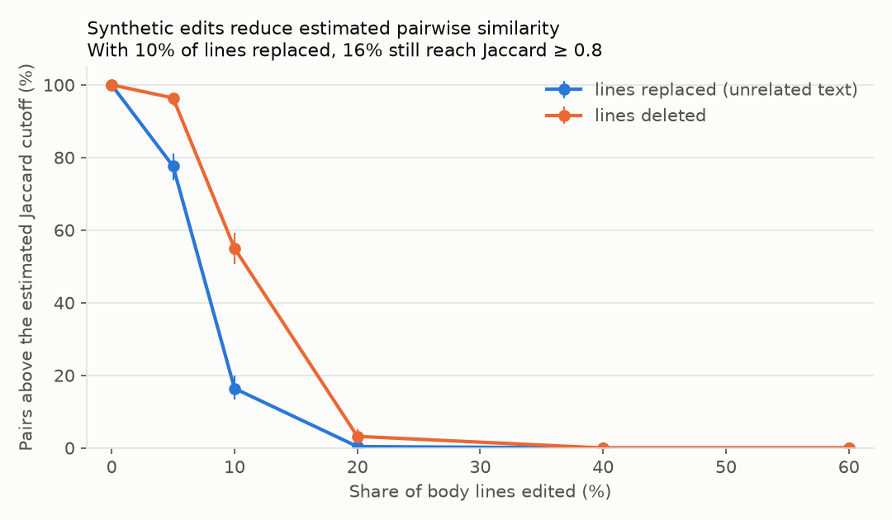

*Source: `results/s4_edit_robustness.csv` · 500 registry skills, 5 edit levels, 2 edit types*

The similarity threshold is a soft line, not a hard one:

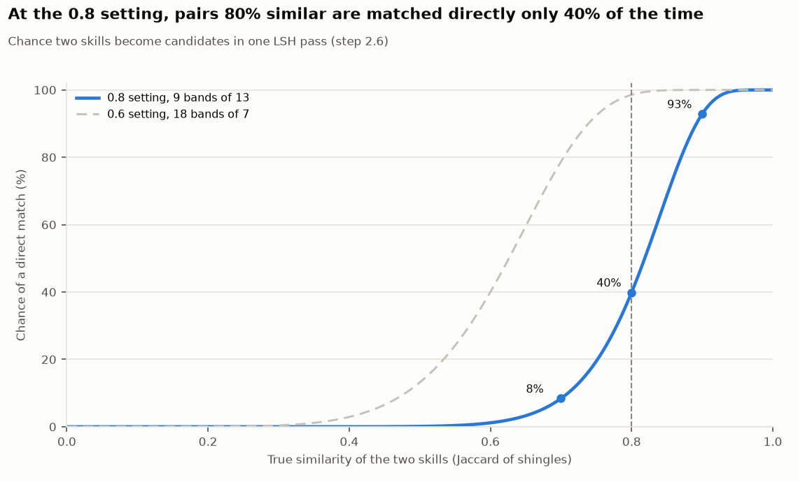

*Computed from the band settings MinHashLSH chooses for 128 numbers · 0.8 and 0.6 thresholds*

**Limit.** The positive-only registry reference cannot establish false-positive rates.
The existing single-document blind sheet hides comparison evidence and therefore
does not independently validate the copy-based label. Structural signals mark about
113,000 additional candidates; these are not validated templated additions.

A separate evidence-aware review now supplies paired full texts, shared passages,
exact body-shingle Jaccard and diffs for registry, cluster and scaffold cases.
Material reuse and shared scaffold are judged separately, with `uncertain` retained.
The original authorship annotations are unchanged. Human pair judgments remain
pending; see [the repaired evaluation and reviewer instructions](TEMPLATE_EVALUATION.md).

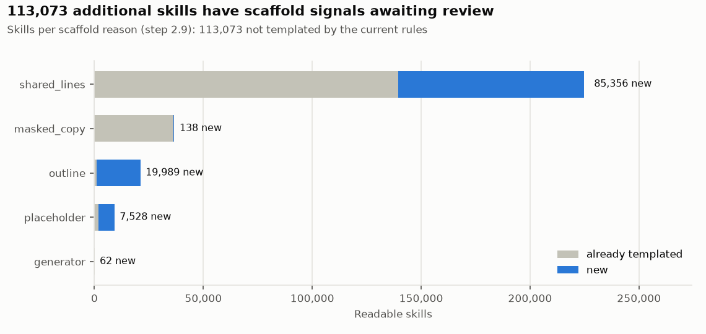

*Source: `results/s4_scaffold_overlap.csv` · 291,903 skills with a scaffold reason*

## Finding 2: Disclosure-based rules agree with one reader on many agent labels

**Question.** How often does a reader agree with disclosure-based labels, and is there
evidence that the fuller rules improve over simple shortcuts?

**Test.** A person labelled 120 sampled skills without seeing the pipeline's answer. Compare the rules with three shortcuts on the same skills.

**Result.** A agrees with 25/30 agent labels (83.3%; Wilson interval 66.4–92.7%) and
23/28 trailer-only labels (82.1%; 64.4–92.1%). The estimates are descriptively similar,
but equivalence or superiority has not been established. The denominators are different
predicted subsets, despite coming from the same 120-item sample. Folder-only agreement
is 32/57 (56.1%). That comparison does not by itself exclude tool-family or workflow
confounding.

Similar trailer-only performance says nothing decisive about whether the disclosure
concerns original writing, installation, synchronization or later maintenance. That
requires separate provenance or workflow evidence. A's answers are judgments of the
visible signal, not independently verified authorship.

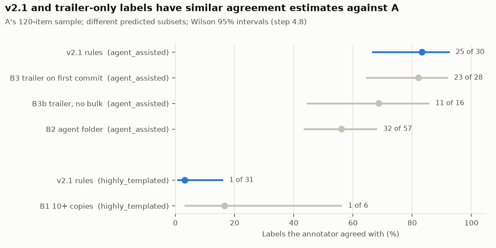

*Source: `results/s4_spot_precision.csv` · v2.1 and baselines on the same 120 skills*

**Limit.** These rules observe disclosures and coding-agent-bot metadata. They do not
measure all agent use. Among sampled registry histories with an observed disclosure,
8% are visible only in middle commits (17% for histories with at least three commits).
This is coverage of recorded disclosures in selected registries, not recall of actual
agent-assisted authorship across GitSkills.

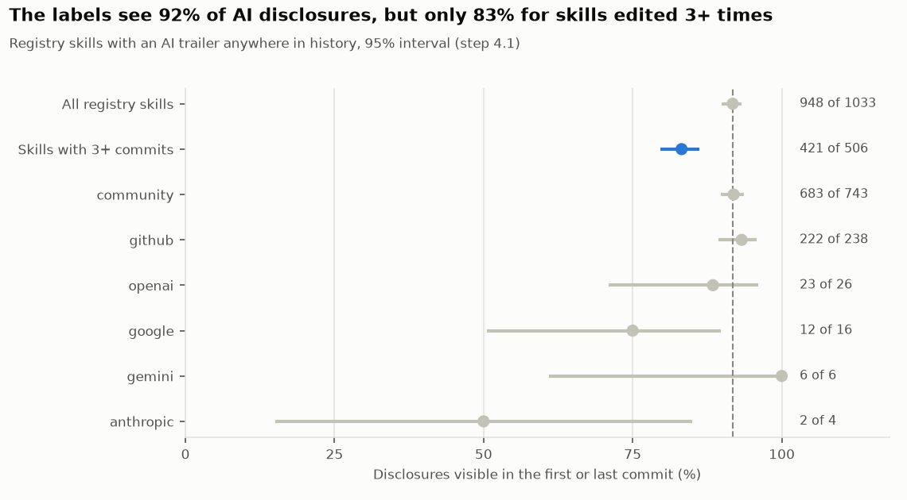

*Source: `results/s4_disclosure_recall.csv` · 1,033 registry skills with an AI trailer*

## Finding 3: The historical likely-human label remains unvalidated

**Claim.** The likely-human label finds skills a person wrote.

**Test.** The same blind spot-check.

**Result.** A agrees with 6/30 historical likely-human labels and assigns 11 of them
agent-assisted. This challenges the rule's interpretation against that reader, but
does not establish the true authorship of the disagreements or show that human
authorship is impossible to identify. The rule uses user-account, copy and workflow
proxies plus absent disclosure, rather than verified positive authorship evidence.

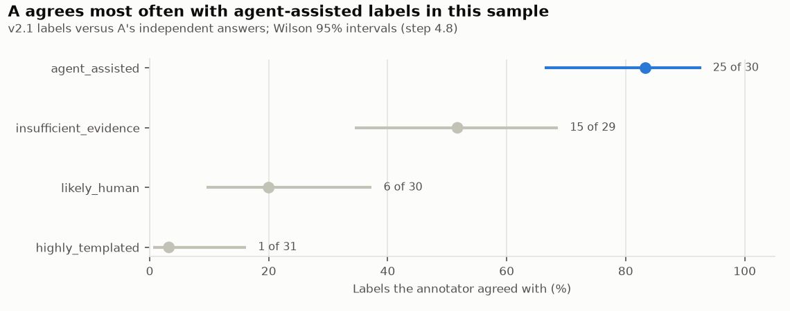

*Source: `results/s4_spot_precision.csv` · person A's sheet, scored 2026-10-27, 120 skills*

The rule assigns low confidence to 83% of its likely-human labels. These confidence
categories are heuristic, not calibrated probabilities of correctness.

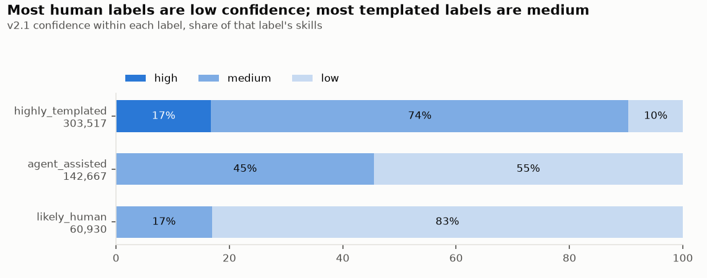

*Source: `results/s3_v2_v21_crosstab.csv` · 507,114 skills with a templated, agent or human label*

**Limit.** A's scores are comparisons against one reference, not verified authorship.
B has now labelled the 40-skill overlap: A and B agree on 21/40 (52.5%; Wilson 95%
interval 37.5–67.1%), with Cohen's kappa 0.288. On those same 40 skills, v2.1's
likely-human label agrees with A on 2/10 and B on 6/10. A third reader, C, labelled 60
of the 120 skills: C agrees with A on 33/60 (kappa 0.308) and with B on 14/21 (kappa
0.465), and agrees with v2.1 on 3/9 likely-human and 20/21 agent-assisted labels. This
reference uncertainty limits interpretation of the reported precision. The independent answers are preserved;
see [the annotation review](ANNOTATION_REVIEW.md) for confusion counts and disagreements.

## Finding 4: Text models distinguish proxy labels moderately, with limited coverage

**Question.** How well do the tested wording and structure methods distinguish the
sampled disclosure-positive and historical likely-human proxy groups?

**Test.** Evaluate 20,000 disclosure-positive and 20,000 historical likely-human skills.
Folds group representative repository owners and detected near-duplicate components.
This reduces leakage from those groups; it does not guarantee different true authors
or absence of undetected duplicates across folds.

**Result.** The ensemble reaches AUC 0.711 on these proxy labels, compared with 0.518
for the tested phrase rule. This supports some proxy-label discrimination, not a
no-signal conclusion. At a nominal 90% precision against those proxies and a 50/50
class prior, the reported decided shares are 0.9% of positives and 7.1% of negatives.
The limited coverage does not establish a practical true-authorship classifier.

The separate positive-unlabelled style experiment has a commit-date-only AUC near
0.48. It uses a different target/population and does not rule out temporal confounding
in this experiment. Repository creation date has not been tested as planned.

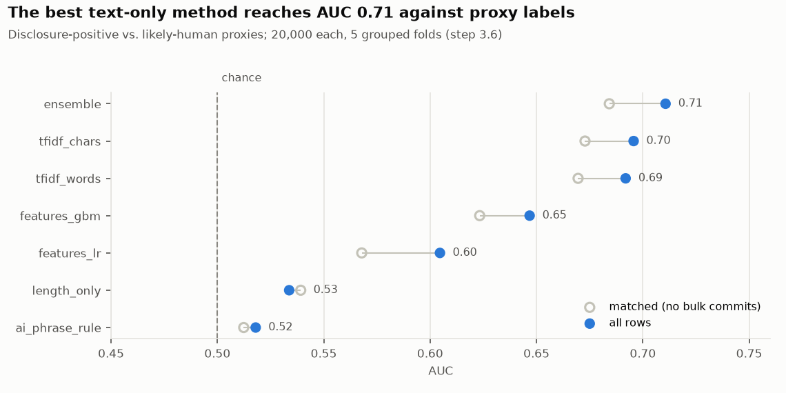

*Source: `results/s3_text_methods.csv` · 40,000 skills with history*

The ROC curves show the whole trade-off behind those numbers:

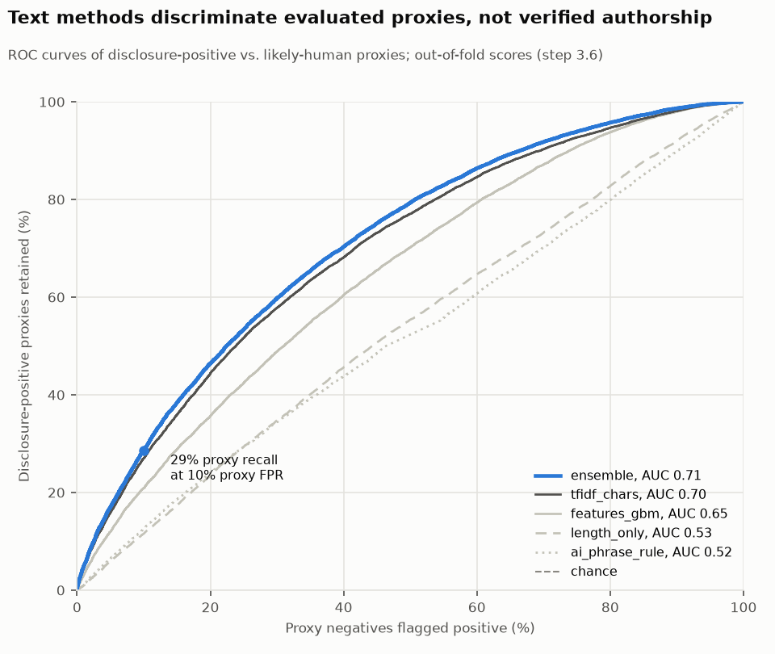

*Source: `src/data/derived/s3_text_methods_oof.parquet` · 40,000 skills, out-of-fold scores*

**Limit.** Negatives can include undisclosed agent use, and disclosure behavior can
depend on tools, repositories and workflows. Label noise and selection can raise or
lower apparent discrimination; no guaranteed lower bound on true-authorship AUC is
established. Reported precision and coverage depend on the assumed class prior and
do not transfer directly to the no-history population. The experiment evaluates
specific methods and settings, not all possible text methods.

## Finding 5: Tested thresholds change aggregate shares; individual stability is unknown

**Question.** How much do aggregate label and confidence shares change when one
configured threshold is varied over the tested values?

**Test.** Recompute the labels on 200,000 skills, changing one threshold at a time.

**Result.** The largest observed label-share shift is about +3.3 percentage points
for templated at cluster setting 0.6. The copy threshold changes that share by about
+1.1 or −0.7 points. Revision thresholds affect confidence shares. These are descriptive
aggregate sensitivity results, not proof that thresholds are arbitrary-free or that
individual decisions are stable.

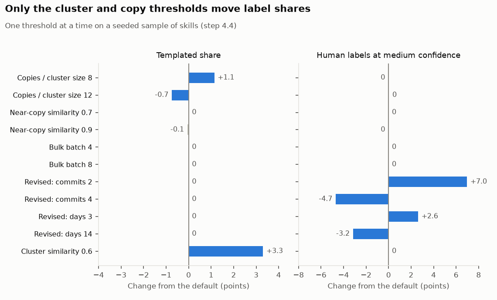

*Source: `results/s4_stability.csv` · 200,000 skills, 11 settings*

**Limit.** Opposing individual label changes can cancel in aggregate. The current
threshold table does not report per-item transitions or churn, so individual stability
cannot be concluded. One-at-a-time settings do not test interactions. The 0.7 near-copy
setting is ineffective because candidates were already filtered at 0.8, and v2.1 can
restore disclosed bulk cases regardless of the bulk threshold. Zero changes under
those settings are not evidence of robustness to all relevant choices.

## What would make the answer firmer

| Gap | Fix |
| --- | --- |
| Single-document annotation cannot validate cross-file copying; near matches are similarity-selected | Exact-reference recovery is now separate; complete the new paired content-reuse/scaffold review |
| Independent raters disagree often: A–B 19 of 40 (kappa 0.288), A–C 27 of 60 (kappa 0.308) | Review disagreements and evidence limits; preserve original answers and record any adjudication separately |
| Repository creation date never tested as a baseline | Add it to the baselines |

## Appendix A: Final labels

The current label (v2.1) gives 303,517 skills templated, 142,667 agent-assisted, 60,930 likely human and 1,370,867 insufficient evidence.

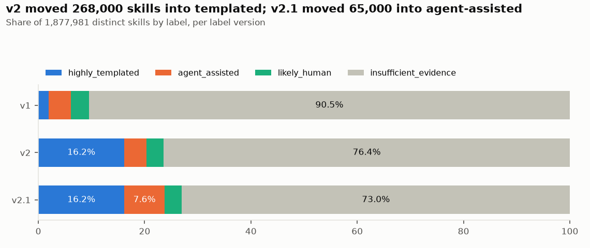

*Source: `results/s3_v1_v2_crosstab.csv` and `results/s3_v2_v21_crosstab.csv` · 1,877,981 distinct skills*

| Commit history | Templated | Agent-assisted | Likely human | Insufficient |
| --- | --- | --- | --- | --- |
| None (1,419,844 skills) | 236,495 | — | — | 1,183,349 |
| Yes (458,137 skills) | 67,022 | 142,667 | 60,930 | 187,518 |

The templated reasons read only the text, so they apply without history too; the agent and human rules need commits.

| Templated reason | No history | With history |
| --- | --- | --- |
| Cluster of 10+ | 190,985 | 45,831 |
| Near copy of a registry version | 33,471 | 8,633 |
| 10+ identical copies | 9,073 | 9,043 |
| Exact copy of a registry version | 2,966 | 3,515 |

## Appendix B: Dataset and pipeline

| Dataset | Count |
| --- | --- |
| `SKILL.md` files | 3,797,117 |
| Distinct skills (unique text) | 1,877,981 |
| Readable distinct skills (200+ body characters) | 1,840,872 |
| Distinct skills with commit history | 458,137 (24.4%) |
| Repositories | 282,200 |
| Snapshot date (end of data collection) | 2026-07-20 |

| Stage | Does |
| --- | --- |
| P, s0 Intake | Builds summary tables, checks the dataset, draws a 50,000-skill dev sample |
| s1 Registry | Mines the history of 31 skill collections; finds 6,719 of their versions unchanged in 216,440 dataset files |
| s2 Features | Measures each skill: commits, repository, type, wording, near-duplicates |
| s3 Labels | Turns the features into one label per skill |
| s4 Validation | Checks the labels against known answers and people |

Design notes for every stage are in [docs/stages/](../stages/README.md).

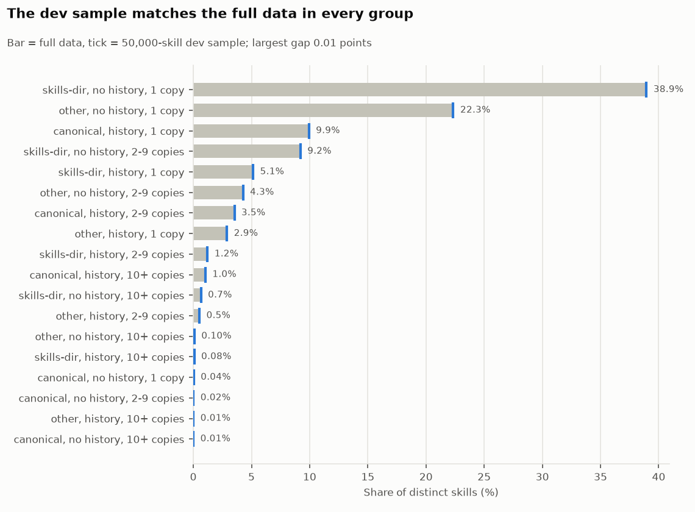

*Source: `src/data/derived/s0_devsample_ids.parquet` against all distinct skills · 18 groups*

**Commit history**, out of 458,137 skills with history: 30.2% have an AI trailer on the first commit (Claude in 131,357 of 138,462), 45.3% were added in a bulk batch of 6 or more, and 13.7% were revised over at least a week.

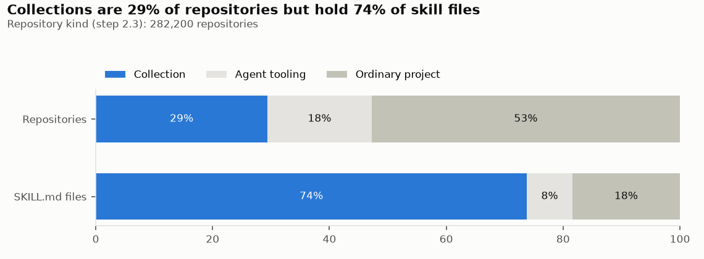

*Source: `src/data/derived/s2_repo.parquet` · 282,200 repositories*

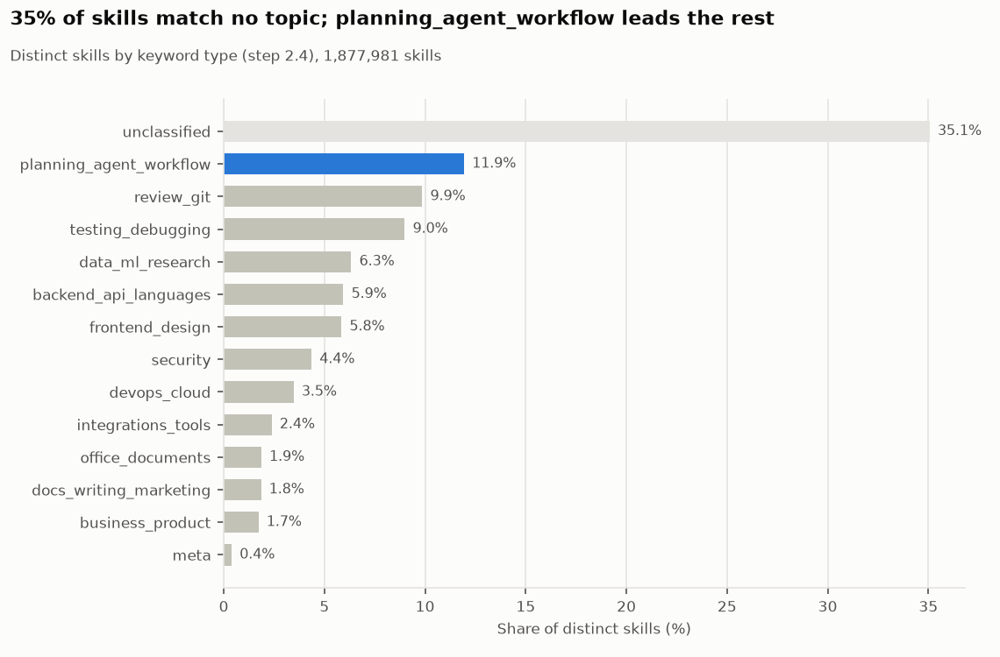

*Source: `src/data/derived/s2_types.parquet` · 1,877,981 distinct skills*

**Near-duplicates:** 15.1% of readable skills sit in a cluster of 10 or more at similarity 0.8. **Wording:** a typical skill reads at grade 9.5. **Specificity:** a typical skill has 30 identifiers, 32% of them rare.
